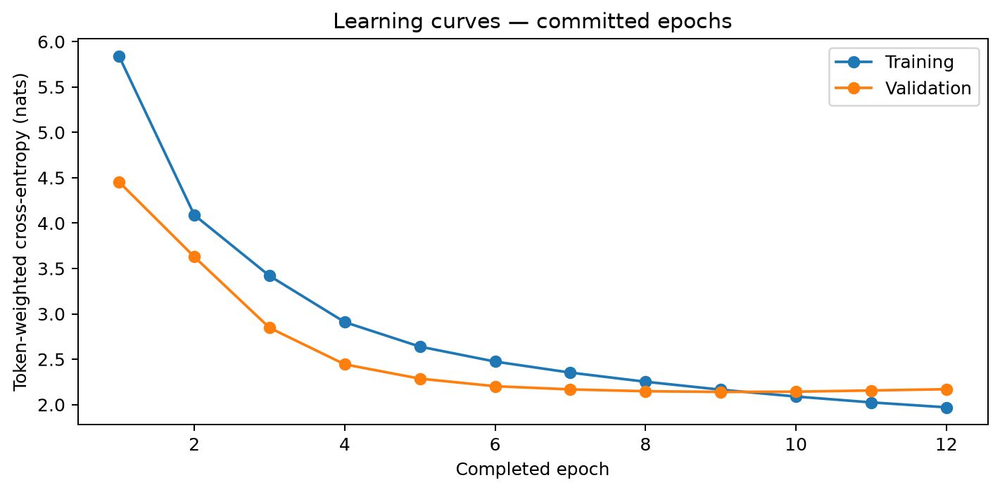

# Stateful Python Code Completion

A notebook-controlled PyTorch experiment in **exact KV-cache reuse, bounded attention-sink caching and editor-session correctness**. It trains a small Python completion model from scratch, then compares quality, latency, memory and recovery across three cache policies.

**Main result:** sink caching made a fixed 32-token warm continuation approximately **4× faster** after a 1,024-position cache filled on an M2 Pro. That benefit came with a **2.55% increase in streaming perplexity**, weak line completion and substantial edit-path regressions. It is a measured systems tradeoff, not a production-readiness claim.

Start with the [technical report](reports/run_001/README.md), [aggregate results](reports/run_001/summary.json) and [Sequence Systems evidence index](docs/sequence-systems.md). The index connects this experiment with independent studies of source order, temporal learning and model capacity; none is a code, dataset or checkpoint dependency.

## Results at a glance

| Measurement | Recorded result |
|---|---|
| Training population | 5,000 training / 1,000 validation / 15,937 test files |
| Model | 31,465,984 parameters; 8 decoder blocks; FP32; 1,024-token context |
| Training | 12 epochs before early stopping; selected epoch 9; 13 h 46 min on M2 Pro |
| Held-out next-token accuracy | 60.04% |
| Exact next-line match | 87/5,000, or 1.74%; 65.76% of suggestions blank or empty |
| Warm 32-token continuation, after capacity, budget 1,024 | Stateless 1,243 ms / exact 1,250 ms / sink 307 ms |
| Streaming perplexity, after capacity, budget 1,024 | Stateless/exact 7.39 / sink 7.57 |
| Historical correctness evidence | 194 passing acceptance tests; 36 trained parity cases; 900/900 restart replay checks |

Continuation times are averages of three block medians and exclude initial source setup. Timings use 36 cases from six validation files. Exact midpoint edits took about 3.86 s versus 39 ms stateless; a separate sink HTTP prefix edit took 6.84 s. Faster continuation does not imply faster handling of every editor operation. One seed and one machine limit generalization. Generated Python was never executed.



The separate 64-case validation audit found 56 prompt/full-source tokenization differences and 46 crossing BPE boundaries. Decoder/stopping and round-trip checks passed; CPU/MPS outputs agreed. This establishes a token-boundary mismatch and an association with blank/EOS failures, not a proven cause or remedy. Details and limits are in the report.

## What is included

```text
src/                         Model, data, training, cache, sessions, API and evaluation
notebooks/                   Notebook with 68 explained, single-purpose action cells
tests/                      Correctness and recovery tests
reports/run_001/              Portable report, figures, tables and aggregate evidence
docs/sequence-systems.md      Related experiments and their limitations
docs/sharing.md               GitHub inclusion rules and verification scope
scripts/                     Separate validation-audit helper
requirements.in              Editable direct dependencies
requirements.txt             Exact, hashed dependency lock
```

Use this existing project directory as the GitHub repository root. Source, tests, the [original executed notebook](notebooks/stateful_code_completion.ipynb), license, setup instructions and curated `reports/` are eligible for tracking. The notebook retains its saved outputs and execution counts unchanged; its older preparation prose is historical, while this README provides the current setup and run instructions.

The `.gitignore` excludes **dataset/cache directories, fitted tokenizers, weights, full experiment runs and environments**. Saved notebook outputs include illustrative source excerpts and historical local paths; they are part of the preserved notebook, not a downloadable dataset or a portable environment. Reading the report requires no runtime setup. Running inference in a fresh checkout requires completing training and freezing a checkpoint; no pretrained model is downloaded automatically.

The author's original environment and raw/prepared/encoded data were deliberately deleted on 30 September 2026. Original run artifacts, model exports and fitted tokenizers remain local under ignored paths; the original executed notebook remains eligible for Git. Rebuilding the environment and acquiring data is therefore required for any new local experiment too.

## Setup on Apple Silicon macOS

The recorded environment was native **arm64 Python 3.13.15**, PyTorch 2.14.0 and macOS on an M2 Pro with 16 GB unified memory. This lock was resolved on macOS. Linux/CUDA installation has not been validated; Windows is unsupported by the current POSIX file-lock implementation. Device selection in the code is MPS → CUDA → CPU, without silent operation fallback.

Install [uv](https://docs.astral.sh/uv/getting-started/installation/) first. Open a terminal in the project directory you downloaded or cloned—the folder containing this README and `src/`—then run:

```bash
uv python install 3.13.15
uv venv --python 3.13.15 .venv
uv pip sync --python .venv/bin/python --require-hashes requirements.txt
.venv/bin/python -m ipykernel install --user --name stateful-code-completion-py313 --display-name 'Stateful Code Completion — Python 3.13'
.venv/bin/python -m jupyterlab notebooks/stateful_code_completion.ipynb
```

Select **Stateful Code Completion — Python 3.13** in Jupyter. In VS Code, open the project directory, open the notebook, and select that kernel or this project's `.venv/bin/python`. If an old kernel points to a removed environment, rerun the registration command above after recreating `.venv`.

Install from the existing lock; do not regenerate it during normal setup. The project uses ordinary local modules, with no editable application-package installation and no training CLI. The workflow follows uv's [requirements synchronization](https://docs.astral.sh/uv/pip/compile/#syncing-an-environment) and [Jupyter environment guidance](https://docs.astral.sh/uv/guides/integration/jupyter/#using-jupyter-with-a-non-project-environment).

## Run the notebook

Run cells from top to bottom. Each numbered action has a preceding explanation. **Run All launches the full experiment**, including data acquisition, training, evaluations and lengthy benchmark stages; it is not a quick demonstration.

1. **Configure a fresh experiment in actions 1–14.** Keep `RUN_NAME = None` in action 7. Set configuration before creating the run. Action 12 allocates `runs/run_001`, `run_002`, and so on without overwriting existing runs. The notebook sets the Metal preference before importing PyTorch and CPU threads before model operations.
2. **Acquire and prepare data in actions 15–21.** Downloads happen only at action 15. Inspect the audit before proceeding. A cold preparation parses and deduplicates the eligible corpus before selecting the final 5,000 training and 1,000 validation files; its progress total is therefore larger than 5,000. Only selected training files fit the tokenizer. Encoding remains within file boundaries.
3. **Build, check and train in actions 22–29.** Action 25 runs the authored acceptance suite; 26 checks the configured runtime; 27 trains or resumes. Failures stop the operation rather than silently altering precision, batch size or device. Review training status and curves afterward.
4. **Freeze and evaluate in actions 30–40.** Release the training model, freeze the validation-selected checkpoint, then evaluate held-out token/line/streaming quality. Fix the validation timing panel and check trained parity before direct-engine benchmarks.
5. **Demonstrate the API in actions 41–55.** Start the localhost service, create/update a session, request a suggestion, explicitly accept or reject it, and demonstrate editing and restart recovery. The default example rejects the suggestion. Accepted source is authoritative; proposals cannot modify it silently.
6. **Measure and report in actions 56–68.** Run HTTP lifecycle measurements, close the client/service, then measure loading/restart replay. Generate each chart, assemble the report and confirm service shutdown.

| Action range | Main outputs |
|---|---|
| 1–14 | Saved configuration, source/dependency snapshot, runtime identity |
| 15–21 | Download inventory, split audit, tokenizer, encoded windows |
| 22–29 | Correctness receipts, checkpoints, training logs and curves |
| 30–40 | Frozen checkpoint, quality results, parity and engine measurements |
| 41–55 | Explicit session/edit/accept/reject/recovery demonstration |
| 56–68 | HTTP/restart results, figures, tables and checksummed report |

The original scientific fit took 13 h 46 min; that is an observation, not a fresh-run ETA. Preparation, validation, evaluation and benchmark costs depend on the machine and environment. Use the notebook's progress/status output for the new run. The original large preparation cache is not required: cold preparation rebuilds it from creator data. A new cold cache has a different identity from the original subset-view cache, so use a fresh run and inspect its audit rather than forcing old cache bindings.

### Configuration and stopping

| Setting | Default |
|---|---|
| Data | 5,000 training files; 1,000 validation files; all eligible test files |
| Tokenizer | Training-only byte BPE, 8,192 entries, whitespace preserved |
| Architecture | 8 layers; width 512; 8 heads × 64; SwiGLU FFN 1,536; pre-RMSNorm; RoPE; tied embeddings |
| Training | FP32; context 1,024; seed 42; dropout 0.1 |
| Optimizer | AdamW; peak LR `3e-4`; 5% warm-up then cosine to `3e-5` |
| Batch | Microbatch 4 × accumulation 8; token-weighted loss |
| Stopping | Maximum 15 epochs; minimum 5; patience 3; meaningful improvement `1e-4` |
| Execution | Validation batch 16; six CPU threads; zero loader workers; Metal preference enabled |
| Cache budgets | 256, 512, 1,024 total retained positions |

Configuration changes require a fresh run. The original stopped after epoch 12 and selected epoch 9; 15 epochs is a maximum. Fast math and implicit CPU fallback remain disabled. Memory/numerical diagnostics stop affected operations; the historical execution tuning does not establish a guaranteed speedup on another machine.

For an intentionally bounded training invocation, change **only action 27** to:

```python
training_result = train_model(run, encoded, model=model, resume=True, stop_after_epoch=1)
```

This stops after one completed epoch, saves recovery state and leaves training incomplete. It preserves the planned 15-epoch learning-rate schedule. Do not proceed to the final evaluation/freeze stage as though training were complete. Remove the bound to continue the original recipe.

### Resume and saved outputs

Resume requires the **same project path, exact environment, source, configuration, backend and data identities**. Restart the kernel, set `RUN_NAME` to your own existing run in action 7, and execute the setup sequence to load its saved configuration. The training action uses the latest committed recovery state. Recreating an environment or moving an old run can invalidate resumption; the published aggregates are not recovery checkpoints. Never edit identity files to bypass those checks.

Datasets and tokenizer caches live under `data/`. Each run saves configuration, source snapshots, recovery and inference artifacts, TensorBoard events, readable logs, CSV/JSONL metrics, evaluation records, figures and a report under `runs/run_XXX/`. Inference uses architecture JSON + tokenizer + safetensors, rather than pickling a complete model. Recovery snapshots also store optimizer, scheduler, RNG, data-order and early-stopping state.

To inspect logs after a run exists, replace the example name with your run:

```bash
.venv/bin/tensorboard --logdir runs/run_001/tensorboard
```

## Cache and session design

| Policy | Semantics |
|---|---|
| Stateless | Recompute the last `W` tokens, with positions rebased to zero |
| Exact | Reuse an unchanged token prefix while the retained window origin is unchanged; rebuild after a left-edge shift |
| Sink-plus-recent | Retain BOS + three source tokens and the newest `W − 4` positions; evict one oldest non-sink before each new token |

Sink caching retains states influenced by older context and is approximate. It does not attend to discarded source or implement exact sliding-window attention. Unrotated keys are re-rotated at retained positions, and eviction after capacity is defined one token at a time, independently of request chunk size.

Source updates retokenize the full prefix and invalidate after the longest unchanged token prefix. Suggestions use private cache branches and are bound to a source revision. Acceptance appends all or a selected character prefix; rejection/cancellation leaves accepted source unchanged. Recovery persists accepted source and identities, then replays it to reconstruct model state.

The FastAPI service is started and stopped by notebook functions. Defaults are localhost, four resident sessions, one generation worker, a queue of eight, a 120-second deadline and 1 MiB of accepted UTF-8 source per session. Completion is greedy and stops at newline, EOS or 64 generated tokens. It uses incremental UTF-8 decoding. Training and serving share an exclusive accelerator lease and do not run concurrently on the accelerator.

## Checks and reproducibility

After setup, optional standalone checks are:

```bash
.venv/bin/python -m pytest -q
.venv/bin/ruff check src tests scripts
.venv/bin/ruff format --check src tests scripts
```

These are executable tests, including synthetic training/inference and available backend checks. Action 25 additionally saves a receipt bound to your new run. Historical passing counts in the report describe the original environment; they are not a claim that a new installation has already passed.

The GitHub preparation used static syntax/notebook/link checks, source comparisons, evidence hashes and isolated ignore-rule checks. It did not recreate the deleted environment, acquire data, execute the notebook, rerun the acceptance suite, train or benchmark. Follow [the sharing guide](docs/sharing.md) to use this project in place and inspect which files Git will include.

## Research

- [Py150](https://www.sri.inf.ethz.ch/py150) and [Py150 Open](https://github.com/google-research-datasets/eth_py150_open/tree/864c140cafa7e104948d7c04cba6d1b1b4d483a6): creator data and pinned eligibility manifests; this is a derived split, not the official benchmark split.
- [CodeXGLUE completion](https://github.com/microsoft/CodeXGLUE/tree/main/Code-Code/CodeCompletion-token): token prediction and generated completion require different metrics.
- [RoFormer](https://arxiv.org/abs/2104.09864): rotary positional embeddings.
- [StreamingLLM](https://arxiv.org/abs/2309.17453): motivation for sink-plus-recent retention. This small scratch-trained Python model is an adaptation, not a reproduction.

Original code is [MIT licensed](LICENSE). See [third-party notices](THIRD_PARTY_NOTICES.md) for data and dependency boundaries.
