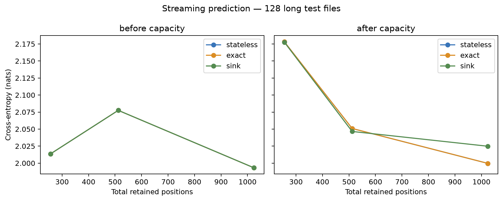
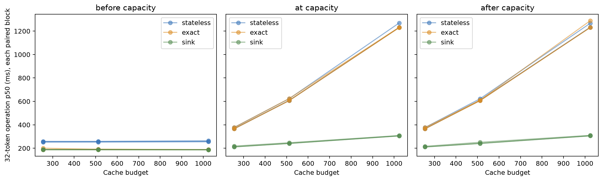
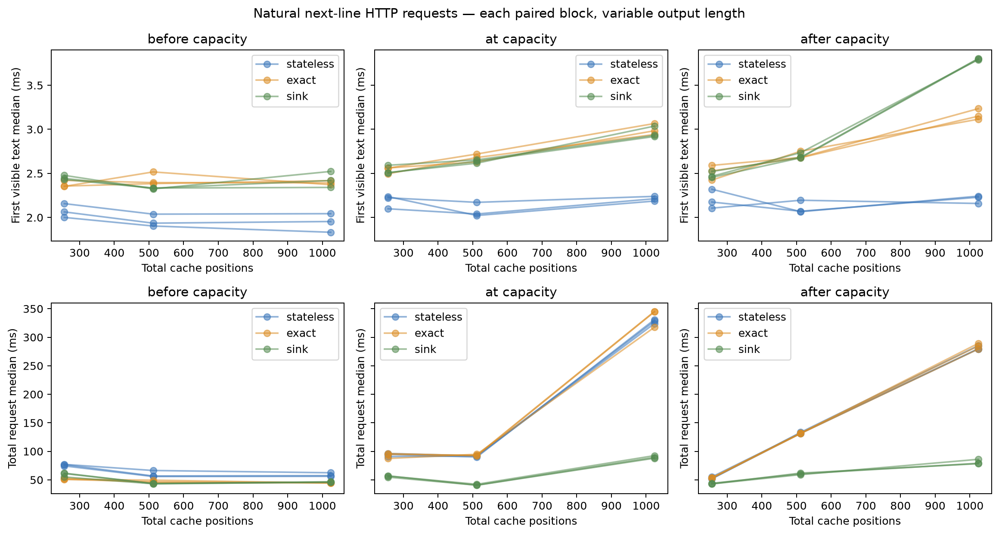
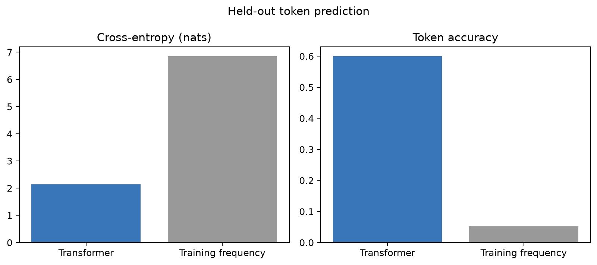
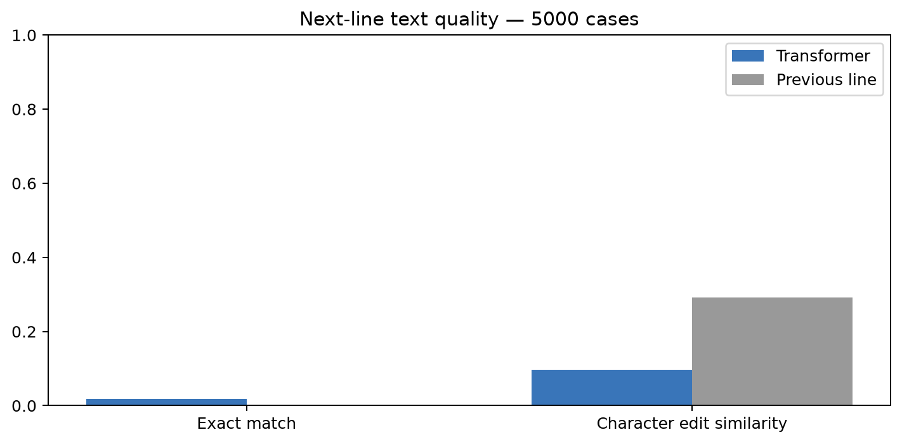
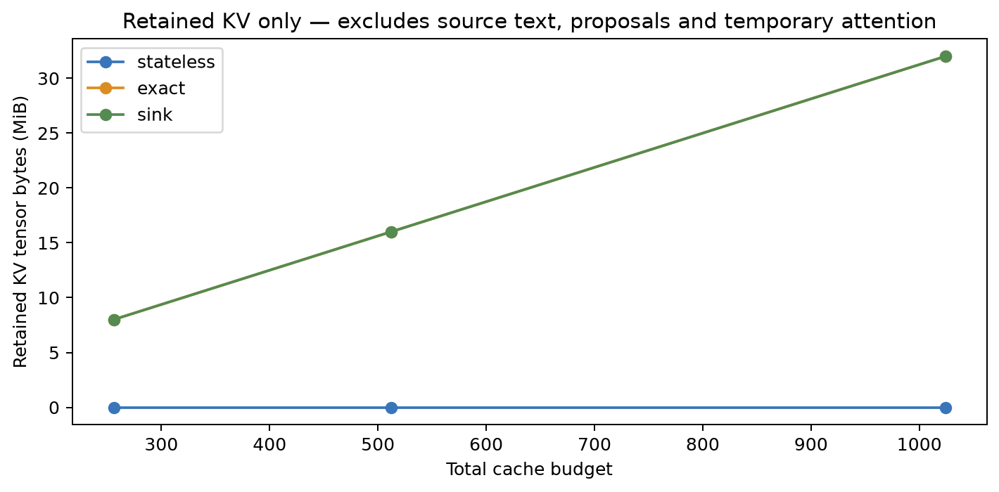
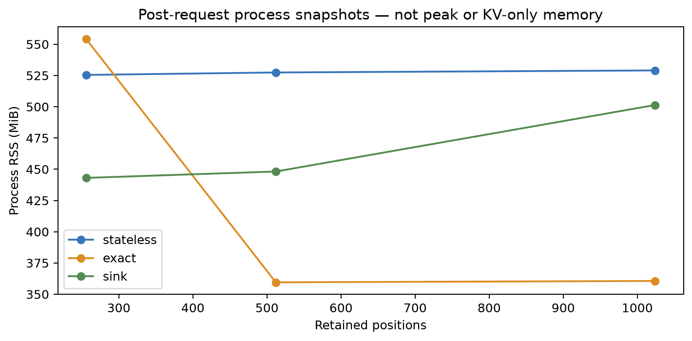

# Stateful Python Code Completion: completed run results

The completed `run_001` answers the research question: **exact reuse preserves predictions but loses its speed advantage once the window moves; sink caching makes warm continuation faster, with a measurable quality tradeoff and costly source-edit paths.** The scratch-trained model predicts individual tokens substantially better than a frequency baseline, but its generated next lines remain weak.

These are descriptive results from one completed experiment. They establish neither functional code correctness nor production readiness. A weak model or a cache slowdown is an admissible outcome of the approved experiment.

This portable report contains the completed experiment's numerical results, original figures and selected aggregate receipts. [Machine-readable results](summary.json) contain configurations, identities and per-block aggregates; [provenance](provenance.json) records original file hashes and every export transformation. The public export omits dataset source, case text, model weights, session records and machine-local paths. It is sufficient to inspect the claims, but not a distribution of the original trained model or every run artifact. Measurements describe the saved source snapshot; later implementation changes require new evidence before a speed claim can be updated.

## Experiment and training outcome

| Setting | Executed value |
|---|---|
| Data | Py150-derived split: **5,000 train / 1,000 validation / 15,937 test files** |
| Split controls | Repository and verified clone groups; seed 42; five-token shingles; 128 MinHash permutations; exact candidate Jaccard threshold 0.90 |
| Preparation | Verified subset view of the full preparation cache; source files were referenced rather than copied |
| Tokenizer | Training-only byte BPE, 8,192 entries including four special tokens |
| Architecture | **31,465,984 parameters**; 8 blocks, width 512, 8 heads, head width 64, SwiGLU feed-forward width 1,536 |
| Attention and norms | RoPE base 10,000; pre-RMSNorm epsilon `1e-5`; tied input/output weights; no linear biases |
| Training sequence | 1,024 tokens; dropout 0.1; FP32 |
| Optimizer | AdamW, peak LR `3e-4`, minimum LR `3e-5`, betas `(0.9, 0.95)`, epsilon `1e-8`, matrix weight decay 0.1 |
| Schedule and clipping | 5% warmup then cosine over the planned 15 epochs; gradient norm limit 1.0 |
| Batching | Microbatch 4 × accumulation 8 = **32 windows/update**; validation batch 16 |
| Execution | MPS, native arm64, PyTorch 2.14.0, six CPU threads, zero loader workers, Metal preference enabled; FP32, no CPU fallback or fast math |
| Stopping | At least 5 and at most 15 epochs; patience 3; meaningful validation improvement `1e-4` |
| Service | Localhost; 4 resident sessions; queue of 8; 120-second deadline; source limit 1 MiB; greedy output up to newline, EOS or 64 tokens |
| Cache policies | Stateless, exact, sink; budgets 256/512/1,024; four sink positions count inside each budget |

**Training completed normally through early stopping at epoch 12.** The selected checkpoint is **epoch 9**, update 3,069, with validation cross-entropy **2.1404**. The final checkpoint is epoch 12, update 4,092; it is preserved separately and was not selected for evaluation. Validation loss rose to 2.1703 while training loss continued falling, so the saved best checkpoint was the appropriate selection under the frozen rule.

The training invocation took **13 h 46 min** (49,571.7 seconds), including input, updates, validation, logging and durable checkpoints. Recorded update computation totaled 13.49 hours, validation 15.61 minutes and checkpoints 47.85 seconds. These components are reported using their recorded boundaries; validation input waiting is already inside validation time. This duration excludes the later evaluation and benchmark notebook cells.

Evidence: [configuration](configuration.json), [training status](evidence/training_status.json), [epoch metrics](tables/epochs.csv), [wall-time receipt](evidence/training_timing.json), [frozen checkpoint selection](summary.json).

## What the model learned—and where it fails

| Held-out measure | Model | Baseline |
|---|---:|---:|
| Token accuracy | **60.04%** | 5.25% |
| Token cross-entropy, lower is better | **2.1350** | 6.8577 |
| Token perplexity, lower is better | **8.4567** | 951.2157 |
| Next-line exact match | **1.74% (87/5,000)** | 0.04% (2/5,000) |
| Next-line character edit similarity | **9.67%** | **29.16%** |

Token prediction scored **23,744,515 targets across 32,742 test windows**, using the true prefix for each prediction. Its baseline is smoothed training-token frequency. Next-line generation evaluated 5,000 deterministically selected test cases; its baseline copies the preceding physical line. These are different tasks and different baselines.

The model has learned useful local token regularities. That does **not** mean it writes correct lines 60% of the time. Autoregressive generation feeds the model's own choices back into later predictions, and whole-line success requires every character—including indentation—to match. On character similarity, copying the previous line outperforms this model. This is evidence of weak completion quality despite the much stronger token score.

Saved predictions show the practical severity: **1,342 are empty (26.84%) and another 1,946 contain only a newline (38.92%)**. Together, **3,288/5,000 cases (65.76%) provide no substantive completion text**. The median is one generated token and the mean is 3.5888 tokens. Of the 87 exact matches, 56 are a closing parenthesis, bracket or brace after stripping whitespace. These are valid literal matches, but the result should not imply success on substantial statements.

The original report records the following overlapping heuristic failure labels. Labels are not mutually exclusive and must not be summed into a number of failed cases. The separate validation-only audit below diagnoses model/prefix behavior; it does not independently validate these classifier labels.

| Recorded label | Cases | Share of 5,000 cases |
|---|---:|---:|
| Indentation mismatch | 4,032 | 80.64% |
| Empty suggestion | 1,342 | 26.84% |
| Premature EOS | 1,342 | 26.84% |
| Other text mismatch | 622 | 12.44% |
| Identifier mismatch | 609 | 12.18% |
| Truncation | 61 | 1.22% |
| Repetitive output | 34 | 0.68% |

The label names are diagnostic heuristics, not compiler errors or proof of causation. Generated Python was never executed. In particular, an indentation mismatch does not by itself prove a syntactically invalid program, and a matching identifier is not proof of correct behavior.

Evidence: [token metrics](metrics/token.json), [line metrics](metrics/line.json), [output-distribution aggregates](summary.json) (case text is omitted from this export).

## Cache speed and prediction tradeoff

All timing comparisons use the same frozen checkpoint and panel. The protocol rotates policy order over three blocks, with 20 warmups and 100 measurements per engine/HTTP group. The tables below average the three **block medians**. Speedups are the median of stateless/policy latency ratios paired **within the same block, budget, regime and workload**; a speedup is therefore not necessarily exactly the ratio of the rounded table values.

For the equal-work **32-token continuation after capacity**:

| Budget | Stateless | Exact reuse | Sink | Sink speedup |
|---|---:|---:|---:|---:|
| 256 | 370.0 ms | 369.9 ms | 212.9 ms | **1.74×** |
| 512 | 613.7 ms | 608.1 ms | 244.4 ms | **2.52×** |
| 1,024 | 1,243.3 ms | 1,249.8 ms | 307.3 ms | **4.03×** |

Before capacity, exact reuse improves this workload by approximately **1.34–1.38×**. Once the window moves, exact mode must recompute the retained context to preserve the stateless definition, and its speed advantage disappears. Sink mode keeps previously computed states and evicts older non-sink positions, making warm continuation faster. Those retained states still contain influence from discarded context, so sink is an approximation rather than exact sliding-window attention.

The streaming-quality experiment scored shared positions every 32 tokens in **128 long test files**, capped at 4,096 tokens each. The following values are **after capacity**:

| Budget | Stateless/exact perplexity | Sink perplexity | Stateless accuracy | Sink accuracy |
|---|---:|---:|---:|---:|
| 256 | 8.8306 | 8.8256 | 59.00% | 59.31% |
| 512 | 7.7748 | 7.7409 | 61.47% | 61.61% |
| 1,024 | **7.3864** | 7.5748 | **62.18%** | 61.56% |

Exact matches stateless prediction quality to numerical precision. Sink shows small descriptive improvements at budgets 256 and 512, but **worse quality at 1,024**: perplexity increases by about 2.55% and accuracy drops about 0.62 percentage points. There are no confidence intervals or multiple training seeds here, so the small differences are not claims of statistical significance. Before/after groups and different budgets do not all score the same position sets; compare policies within a budget and phase.

Evidence: [engine block summary](tables/engine_summary.csv), [engine measurement aggregates](summary.json), [streaming metrics](metrics/streaming.json).

## The main implementation bottleneck: rebuilding after edits

Faster warm continuation does not imply a faster complete editor workflow. The saved implementation sometimes retains an unchanged prefix and then reconstructs a long suffix one token at a time; a bulk recomputation can be far faster.

| Operation at budget 1,024 | Stateless | Exact | Sink |
|---|---:|---:|---:|
| Engine midpoint edit after capacity | **38.6 ms** | 3,858.8 ms | 325.4 ms |
| HTTP prepended-comment edit at capacity | **41.4 ms** | 42.7 ms | 6,835.6 ms |
| HTTP prepended-comment edit after capacity | **41.3 ms** | 42.8 ms | 375.5 ms |

The first row isolates a fixed-length token edit; the HTTP edit inserts text and retokenizes. They trigger different rebuild paths and should not be treated as identical edits. The several-second regressions are an observed limitation of this implementation, not an unavoidable cost of exact or sink caching in every implementation. Bulk suffix/prefill rebuilding is a follow-up optimization candidate; these results do not claim that optimization has already been measured.

For natural next-line HTTP requests after capacity at budget 1,024, completion latency is **281.5 ms stateless / 284.4 ms exact / 81.1 ms sink**. That group generates 12 tokens on average for every policy. Across other groups, output lengths differ, so use the fixed-work engine workload for equal-work speed claims.

Engine timing excludes construction of the initial prefix for continuation/edit workloads. HTTP completion timing includes the request, queue, generation and transfer, but **excludes session creation and initial source preparation**. First-token timings around 2–4 ms start from an already prepared prediction state; they are not latency from pasting an entire source file. The benchmark runs one sequential trace at a time and does not measure high-concurrency throughput or saturated queues.

Evidence: [HTTP block summary](tables/http_summary.csv), [HTTP measurement aggregates](summary.json), [frozen source identity and provenance](provenance.json).

## Correctness, recovery and memory

- The saved acceptance receipt reports **194 tests passed**, zero errors, failures or skips. Synthetic runtime validation passed separately.
- All **36 trained parity cases** passed. Exact/stateless maximum absolute logit difference was **0.0000229**, below the MPS gate of **0.0003**, with zero greedy disagreements. Sink's independent reference comparison also passed; it is a different semantic comparison from stateless parity.
- The engine saved **32,400 measured requests**. HTTP saved **8,100 measured lifecycle traces**, comprising **24,300 measured operation rows**.
- **900/900 measured restart replay checks** preserved greedy output, across 300 measured restarts. These are repeat checks on the fixed panel, not 900 distinct source files.
- Median model loading was **0.942 s** (p95 0.994 s); median service startup was **1.759 s** (p95 1.972 s). These are fresh processes with the operating-system file cache left intact.
- Restoration is additional to startup. Stateless/exact group averages were approximately **41–76 ms**; sink replay after capacity was **237 / 275 / 355 ms** at budgets 256 / 512 / 1,024.

Retained KV cache occupies **8 / 16 / 32 MiB per cache** at budgets 256 / 512 / 1,024. Stateless retains no KV cache but still needs model weights and temporary work. Proposal branches and multiple resident sessions can allocate additional caches.

Engine MPS tensor allocation snapshots had a median of **0.135 GiB** and largest observed sample of **0.182 GiB**; driver allocation was about **1.111 GiB**. Process RSS had a median of **0.513 GiB** and largest sample of **1.464 GiB**. These are instantaneous samples, **not peak memory measurements**. RSS, tensor and driver counters overlap in unified memory and must not be summed. They do not describe training memory.

Evidence: [acceptance receipt](evidence/acceptance.json), [runtime validation](evidence/runtime_validation.json), [trained parity](evidence/correctness.json), [restart results](tables/restart_summary.csv), [startup table](tables/startup_measurements.csv).

## Scope, reproducibility and validation audit

The timing panel has **36 cases from only six distinct validation files**—four files per budget—with repeated measurements. This is a controlled local comparison, not a representative deployment load test. All main findings come from one model, one seed and one M2 Pro environment. Training data was filtered by license, Python 3.13 parsing, duplicates and repository/clone groups; the split is Py150-derived, not the official Py150 benchmark. The [aggregate data audit](evidence/data_audit.json) records those exclusions and the limits of MinHash candidate retrieval.

The [historical integrity receipt](evidence/integrity.json) records a **27 September 2026** review in which all **112 original artifact-manifest entries matched**, all **114 original run files plus the executed notebook** remained byte-identical, and 33 live scientific source/dependency files matched the frozen source manifest. Those counts describe that historical local review, not this smaller public export. The environment and dataset caches were removed afterward. This export preserves their recorded identities and provides [its own checksums](checksums.json) and [source-to-export provenance](provenance.json). Integrity validation detects file changes and internal mismatches; it does not independently reproduce learned results or establish correctness of every implementation choice.

| Identity | SHA-256 or cache ID |
|---|---|
| Selected model weights | `7b6dc503a3e6820cd0ff82dd80b0565f97bae8f9f876cdf62fa2012c96416825` |
| Tokenizer file | `6dd342eb6a1ddf9bf523954d320c5e81b41752d123a369485a9cf6c6a173b354` |
| Prepared data cache | `8fd43d116d66d7c67547b3ed24f26a970c3c2d74514be1251b563ff0a97171b2` |
| Encoded cache | `c869742fd56b0b090a73b2f30cdbd3676f1e932a97d51c4b19a3d5a7e38cb1ce` |
| Frozen source | `f14ab1aa7b9b9132161ed7c20ef466f88f9e9c2a61bb01839c2a92b42f048c47` |
| Benchmark panel | `1b92f4b3fc6dea8977b7966bd48c052c26e952277b4c318bc8bf1b7487069e1e` |

The separate **post-run validation-only diagnostic is complete** on 64 deterministically selected files, with cases frozen before inference. The canonical [MPS audit receipt](metrics/validation_audit.json) uses the saved best checkpoint and six-thread execution settings; the explanation below and [device-confirmation aggregate](evidence/device_confirmation.json) retain the diagnostic conclusions. Source/case text and row-level traces are deliberately omitted from this public export. It is additional diagnostic evidence, not part of the original held-out score, and does not independently validate the heuristic failure labels.

| Boundary/stopping observation | Cases |
|---|---:|
| Prompt-tail tokenization changes when full source is encoded | 56/64 |
| A full-source BPE token crosses the prompt/target byte boundary | 46/64 |
| Immediate EOS with empty output | 19/64 |
| Newline-only output | 27/64 |
| Empty or newline-only output, combined | 46/64 |
| Independent stopping/incremental-decoder checks passed | 64/64 |
| Text round-trip checks passed | 128/128 |

All 19 immediate-EOS cases occurred among the 46 cases with a crossing BPE token; none occurred among the 18 cases with an exact token boundary. This is **an association consistent with a mismatch between whole-file training tokenization and independently encoded editor prefixes**, not proof that the boundary mismatch caused every failure. Other output failures also occur without a crossing token.

The source-token diagnostic predicted its next token correctly in 39/64 cases, but its teacher-forced context and target can differ from the canonical editor prompt at the byte boundary. That number is **not a corrected completion score**. Only 8/64 teacher contexts exactly match the editor histories, and 4 of those 8 still produce newline-only output: the boundary mismatch is not a complete explanation. Canonical suggestions used only the source prefix; gold target text was never fed into their generation state. A [device confirmation](evidence/device_confirmation.json) found identical text, sampled token IDs and stop reasons in all 64 CPU/MPS pairs; this is a device check, not an additional independent sample.

Independent byte decoding agrees with the implemented newline/EOS rules. Some sampled BPE tokens contain bytes after their first newline; clipping those bytes follows the declared next-line protocol. The audit does not demonstrate a decoder implementation bug, a causal quality remedy or improved generation. Validation already contributed to checkpoint selection, and this small diagnostic panel is not a new held-out estimate. Original test predictions and their metrics remain unchanged. The `validation_audit` field in [summary.json](summary.json) records receipt hashes and scope.

The completed evidence supports the bounded research conclusions reported here. Improving generated completions, optimizing edit reconstruction and expanding the benchmark panel are follow-up work. No claim here depends on generated Python being executed, on universal cache acceleration or on production usefulness.

## Figures and block tables

All figures below are byte-identical copies from the completed experiment. Each point in the paired timing plots is a block median; the three blocks are repeated measurements on the same small panel. The scope and preparation exclusions described above still apply.

The [engine](tables/engine_summary.csv), [HTTP](tables/http_summary.csv) and [restart](tables/restart_summary.csv) tables retain the original block summaries. [Startup measurements](tables/startup_measurements.csv) retain the measured process-loading repetitions. [Epoch metrics](tables/epochs.csv) retain the training curve values. None contains source-code examples or session text.
